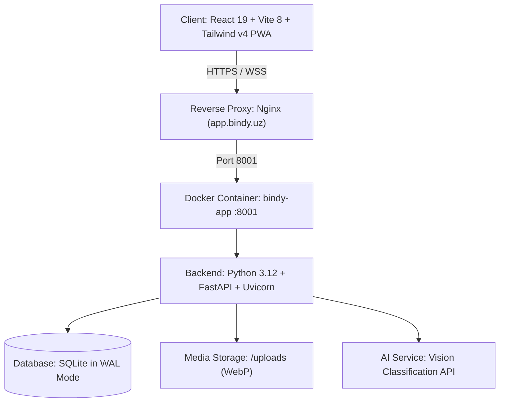

# Bindy — Smart Eco & Recycling Platform

[](https://app.bindy.uz)
[](https://react.dev/)
[](https://www.typescriptlang.org/)
[](https://tailwindcss.com/)
[](https://fastapi.tiangolo.com/)
[](https://sqlite.org/)
[](https://www.docker.com/)

**Bindy** is a mobile-first Progressive Web Application (PWA) designed to gamify urban ecology. It maps recycling containers, empowers citizens to report illegal trash heaps or new recycling bins, verifies waste via AI image classification, and rewards active contributors with eco-points redeemable for real-world vouchers.

---

## 🌟 Key Features

### 🗺️ Interactive GIS & Navigation
* **Multi-Layer Map:** Powered by Leaflet and Carto Voyager / Positron / OpenStreetMap with fluid vector pins.
* **Turn-by-Turn Pedestrian Routing:** OSRM integration calculating real walking paths, remaining distance in meters, and arrival estimates.
* **Community Points & Filtering:** Instant toggles for sorting verified recycling bins, uncollected waste reports, and community contributions.

### 🛰️ Mobile Geolocation Engine
* **Cell-Tower (Cell-ID) Filtering:** Eliminates 1-km cell-tower jumps by filtering coordinates with `accuracy > 200m`, ensuring users are never placed on false cellular base stations.
* **Approximate Location Protection:** Detects Android 12+ coarse location mode (`accuracy > 300m`). Rather than showing misleading coordinates, it hides the false marker and displays a guidance badge.
* **Two-Step Onboarding Bottom Sheet:** [`CoarseLocationPrompt`](src/components/map/CoarseLocationPrompt.tsx) guides users to enable "Precise Location" in their browser, automatically closing and zooming to their building once locked.
* **Free Map Pan (No Snapbacks):** Map centers on user initial fix once, allowing full freedom to explore other city districts without GPS jitter resetting the view. A floating `🎯 Locate` button returns focus instantly.

### 🤖 AI Waste Recognition & Image Optimization
* **Camera FAB & Capture Flow:** Live mobile camera support or photo library upload.
* **Client-Side Canvas WebP Compression:** Reduces 10MB mobile photos to ~150–250 KB (1280px max resolution) directly in the browser before network transmission.
* **Server-Side AI Classification:** Analyzes waste and recycling types, detecting plastic, paper, glass, metal, organic, and electronic waste.

### 👥 Crowdsourcing & Admin Moderation
* **Crowdsourced Reports:** Users can mark illegal trash dumping sites or newly discovered recycling bins with uploaded photos.
* **Role-Based Access Control (RBAC):** Admin users have elevated privileges to moderate, verify, or soft-delete reports across the platform.
* **Server-Sent Events (SSE):** Real-time streaming (`/api/v1/events/stream`) pushes community updates to all connected users.

### 🏆 Gamification, Coin Shop & Profiles
* **Dynamic Eco-Points:** Earn points for contributing verified reports and maintaining daily clean-up streaks.
* **Live Leaderboard:** Real-time city ranking calculated from database activity.
* **Coin Shop:** Redeem points for partner vouchers and promotional discounts.
* **Offline-Ready PWA:** Installable directly to mobile home screens with custom splash screens, offline fallback, and iOS safe-area support.

---

## 🏗️ Architecture & Tech Stack



### Technology Breakdown

| Component | Technology | Description |
|-----------|------------|-------------|
| **Frontend Framework** | React 19, TypeScript | Strict typing, modern hooks, concurrent features |
| **Styling & Design** | Tailwind CSS v4, Lucide Icons | Premium fintech UI, mint-green palette, dark elements |
| **Animations** | Framer Motion | Spring-physics bottom sheets, modal overlays |
| **Mapping & GIS** | Leaflet, react-leaflet, OSRM | Tile caching, vector markers, navigation follow |
| **Backend API** | Python 3.12, FastAPI, Uvicorn | High-performance asynchronous REST API |
| **Database** | SQLite3 in WAL Mode | Thread-safe connection pooling, automated schema migrations |
| **Authentication** | PBKDF2-HMAC-SHA256 | Cryptographic salt + hash, 60-day Bearer session tokens |
| **Containerization** | Docker, Docker Compose | Multi-stage build (`node:22-alpine` + `python:3.12-slim`) |

---

## 📁 Project Structure

```
Bindy/
├── Dockerfile                  # Multi-stage production container build
├── docker-compose.yml          # Docker service orchestration
├── package.json                # Frontend dependencies & scripts
├── vite.config.ts              # Vite 8 configuration with PWA plugin
│
├── server/                     # Python FastAPI Backend
│   ├── main.py                 # FastAPI app, API routes, static file serving
│   ├── auth.py                 # PBKDF2 password hashing & Bearer token auth
│   ├── db.py                   # SQLite connection pooling & schema migrations
│   ├── store.py                # Database queries and mutations
│   ├── gemma.py                # AI vision classification service
│   ├── points.py               # Gamification & eco-point calculation rules
│   ├── admin_config.py         # Admin user permissions & moderation list
│   ├── requirements.txt        # Python backend dependencies
│   └── data/                   # SQLite database directory (`bindy.db`)
│
├── src/                        # Frontend Application Source
│   ├── App.tsx                 # Root application wrapper & auth state provider
│   ├── main.tsx                # Entry point
│   ├── components/
│   │   ├── BindyApp.tsx        # Main navigation shell & layout
│   │   ├── map/                # BindyMap, MapControls, MapStyleSheet, CoarseLocationPrompt
│   │   ├── screens/            # MapScreen, LeaderboardScreen, CoinShopScreen, ProfileScreen
│   │   ├── capture/            # Camera capture modal, preview, processing overlay
│   │   ├── auth/               # Login & Register modal dialogs
│   │   └── layout/             # Bottom navigation bar & header
│   ├── context/
│   │   ├── AppContext.tsx      # Global app state & shared reports
│   │   └── AuthContext.tsx     # Client-side user authentication session
│   ├── hooks/
│   │   ├── useGeolocation.ts   # GNSS tracking, cell-tower filter & accuracy detection
│   │   ├── useNavigation.ts    # OSRM pedestrian routing
│   │   └── useNearbyBins.ts    # Geodesic haversine distance filtering
│   ├── utils/
│   │   ├── imageCompressor.ts  # Client-side Canvas WebP image compression
│   │   └── geo.ts              # Haversine distance & coordinate helpers
│   └── types/
│       └── index.ts            # Core TypeScript interfaces & models
```

---

## 🚀 Getting Started

### Prerequisites
* **Node.js**: v20 or higher
* **npm**: v10 or higher
* **Python**: v3.12 (if running backend outside Docker)
* **Docker & Docker Compose** (recommended for production)

---

### Method 1: Local Development

#### 1. Clone the repository
```bash
git clone https://github.com/USMANGAMES/Bindy.git
cd Bindy
```

#### 2. Backend Setup
```bash
cd server
python3 -m venv venv
source venv/bin/activate  # On Windows: venv\Scripts\activate
pip install -r requirements.txt
cp .env.example .env      # Configure your environment variables
python main.py
```
Backend will start on `http://127.0.0.1:8001`.

#### 3. Frontend Setup
In a new terminal window:
```bash
npm install
npm run dev
```
Open `http://localhost:5173` in your browser.

---

### Method 2: Docker Setup (Production Ready)

Run the entire full-stack application with a single command:

```bash
docker compose build
docker compose up -d
```

The container will automatically:
1. Build the frontend via `node:22-alpine` (`tsc -b && vite build`).
2. Package the static assets into `/app/dist`.
3. Launch FastAPI via `python:3.12-slim` on port `8001`.
4. Persist the database in `./server/data/bindy.db`.

Access the application at `http://localhost:8001` or via reverse proxy.

---

## 🔌 API Reference Overview

The backend exposes RESTful endpoints under `/api/v1`:

### Authentication & Users
| Method | Endpoint | Description |
|--------|----------|-------------|
| `POST` | `/api/v1/auth/register` | Register new user with username & password |
| `POST` | `/api/v1/auth/login` | Login and receive a 60-day Bearer token |
| `GET` | `/api/v1/auth/me` | Fetch active user profile from Bearer token |
| `POST` | `/api/v1/auth/logout` | Invalidate active session token |
| `GET` | `/api/v1/users/{username}/stats` | User submission history, streaks, and eco-points |

### Map Reports & Moderation
| Method | Endpoint | Description |
|--------|----------|-------------|
| `GET` | `/api/v1/reports` | Get active community bins & trash markers |
| `POST` | `/api/v1/reports` | Submit a newly reported bin or trash dump |
| `DELETE` | `/api/v1/reports/{id}` | Admin soft-delete / remove a report |
| `GET` | `/api/v1/hidden-items` | Get IDs of hidden/deleted items |
| `POST` | `/api/v1/upload` | Upload compressed WebP photo to `/uploads/` |

### Gamification & Stats
| Method | Endpoint | Description |
|--------|----------|-------------|
| `GET` | `/api/v1/leaderboard` | Live ranking of top eco-contributors |
| `GET` | `/api/v1/stats/global` | Total trash cleaned & active community bins |
| `GET` | `/api/v1/events/stream` | Server-Sent Events (SSE) live updates |
| `POST` | `/api/v1/analyze` | AI image classification service |

---

## 📱 Progressive Web App (PWA) Installation

* **Android (Chrome / Edge / Samsung Internet):**
  Tap the in-app install banner or browser menu `⋮` → **Install app**.
* **iOS (Safari):**
  Tap the Share button `⎋` → **Add to Home Screen** (`+`).
* **Desktop (Chrome / Brave / Edge):**
  Click the install icon in the address bar to run Bindy as a standalone desktop app.

---

## 🔒 Security & Best Practices

* **Passwords:** Hashed with PBKDF2 using SHA-256 and unique cryptographic salts (never stored in plain text).
* **Sessions:** Stored in SQLite with random 64-character hexadecimal tokens and expiration checks.
* **Uploads:** Direct file extension validation and client-side sanitization.
* **Database:** SQLite running in Write-Ahead Logging (`PRAGMA journal_mode=WAL;`) with busy timeouts to avoid lock contention under concurrent load.

---

## 📄 License

Private project — © Bindy Team. All rights reserved.
